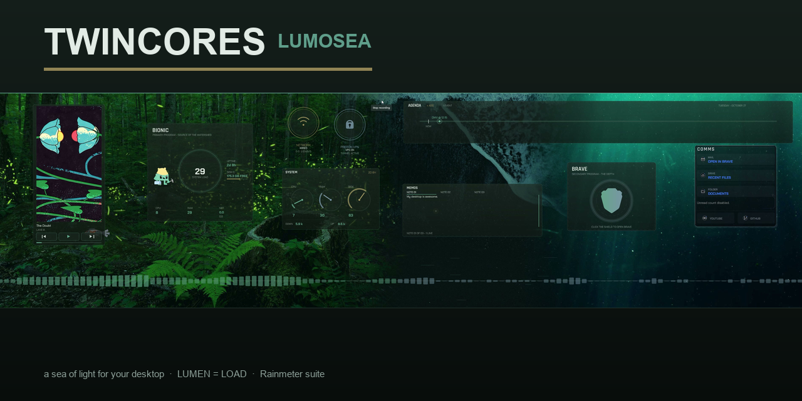
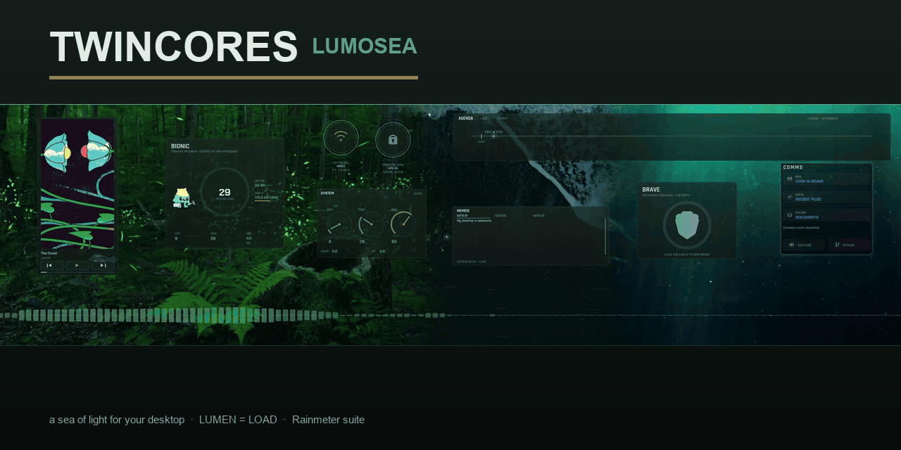

# TwinCores — Lumosea

<p align="center">
  
  <br>
  
</p>

**A Rainmeter desktop suite built around one idea:** **a sea of light for your desktop**.
A single 3840×1080 scene spans both screens — dusk forest (source) → wave crest (transition) → deep water (depth). Work lives upstream, everything ambient lives downstream, and one light level — **LUMEN = LOAD** — drives the glow of the entire system: idle is a candle, load is a bonfire.

## The world

| Zone | Monitor | Meaning |
|---|---|---|
| Forest (source) | M1 left | Primary program: **Bionic** — the AI workspace at the source of the light |
| Crest (transition) | M1 → M2 | The wave — audio waveform runs the full 3840px width, low frequencies on the forest half, high on the deep half |
| Deep (depth) | M2 | Secondary: **Brave**, Art (Spotify), Memos, Comms |

**Palette:** Pine Mist · Night (teal accents on near-black green glass). Hot-switchable alternates ship in the theme set.

## The widgets (sources live under `Watershed/` — folder name kept for Rainmeter config-path stability)

| Widget | What it does |
|---|---|
| **Primary** | Bionic launcher + load ring (LUMEN=LOAD), CPU/RAM/NET stats, uptime, disk, mascot |
| **Secondary** | Brave — twin ring card, click the shield to launch |
| **Art** | Spotify: big album art, transport controls, progress — and when the track has one, the **Canvas video plays right in the widget** (see pipeline below) |
| **Agenda** | Sapline: one horizontal strand — done events dim to the left, next event brightest, NOW marker slides forward. Click-and-type inline; supports dates (`10/27`, `+3`, `tomorrow`, times) |
| **Memos** | Three-tab sticky notes, click-and-type inline, scrollable |
| **System** | Three realtime dial gauges: CPU / RAM / DISK |
| **Core-Ember / Core-Glem** | Edge orbs: live NETWORK state + speeds / Proton VPN tunnel state |
| **Live** | Ambient layer: fireflies in the forest, flow streaks at the crest, plankton in the deep, one traveling pulse — all driven by system load |
| **Wave** | 128-band realtime audio waveform across the full desktop |
| **Load** | Hidden hub: smooths CPU/RAM into the LUMEN level and broadcasts it to every skin every second |

## Spotify Canvas pipeline (`@Resources/Canvas`, `@Resources/Scripts/canvas-bridge.*`)

```
Spicetify extension (canvas-bridge.js)          Rainmeter
  resolves track canvas ──POST──▶ canvas-bridge.py ──▶ canvas-state.json
  (metadata or protobuf                          (127.0.0.1:8795)     │
   canvaz-cache/v0/canvases)                          │               ▼
                              stage.html (WebView2 in the Art widget) ◀── CanvasWatch.lua
```

- The extension resolves the canvas via track metadata or a hand-rolled protobuf request to `spclient /canvaz-cache/v0/canvases`, and pushes the playable URL to the local bridge.
- The Art widget's WebView2 stage polls the bridge, crossfades videos, click = play/pause.
- No canvas for a track (many have none)? The big album cover shows instead — that's correct behavior.
- Requires: [Spicetify](https://spicetify.app) with `canvas-bridge.js` in Extensions + `spicetify config extensions canvas-bridge.js && spicetify apply`.

## Repo layout

```
Watershed/            the suite (internal folder name; one skin per folder —
                      this Rainmeter build enforces one active skin per config)
Comms/                communications widget (mail / drive / quick links)
@Resources/           shared theme, scripts, icons, canvas pipeline
Design/               final desktop plates + brand assets
PROJECT-BOOKMARK.md   project state & hard-won technical facts — start here
```

## Requirements

- [Rainmeter](https://www.rainmeter.net) 4.5+
- Plugins: WebNowPlaying (Redux), WebView2 (NSTechBytes), RunCommand, AudioLevel
- Optional: Spicetify for Canvas videos

## Notes

- Runtime state (agenda CSV, memos, canvas logs) lives in `@Resources/Data/` and is **not** tracked.
- `@Resources/Scripts/tint-icons.py` re-tints all icon assets after a palette switch — run it if you change the theme.
- Design/engineering notes live in [PROJECT-BOOKMARK.md](PROJECT-BOOKMARK.md).
